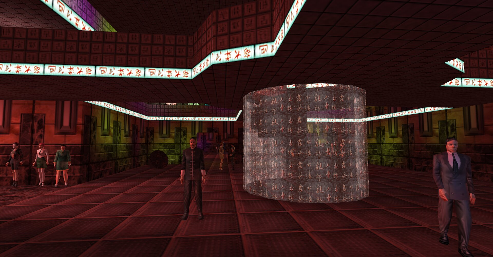
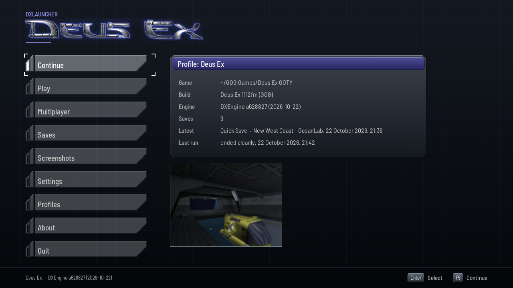
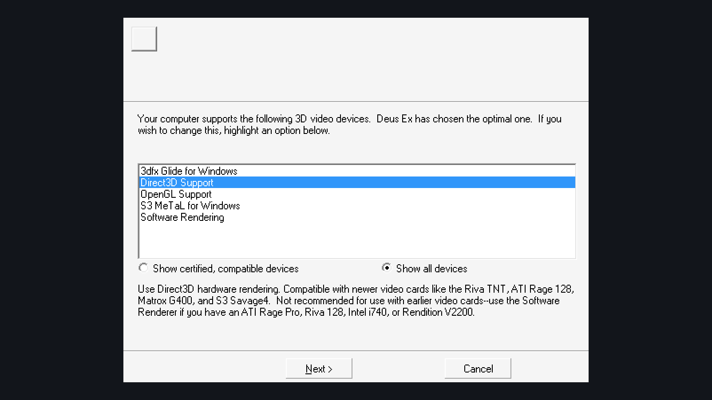
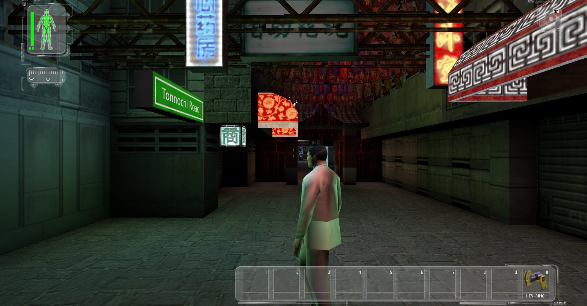
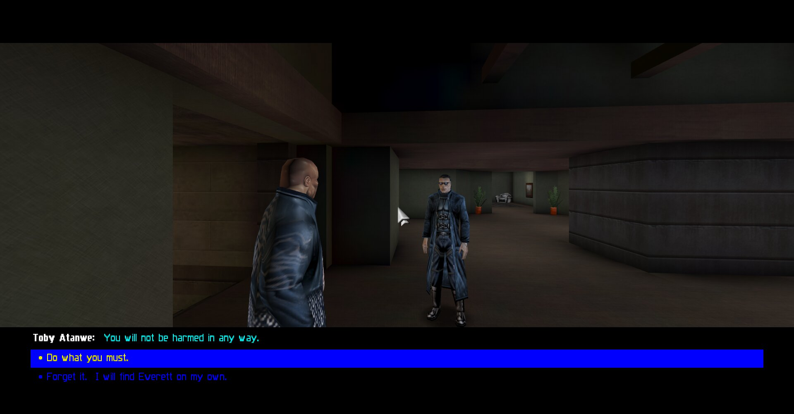

# Port Ex Machina

Deus Ex on modern systems, from the desktop to a handheld:
[DXEngine](https://github.com/JuggyMcNutty/DXEngine), an engine made to play the game as the
original does, and
[DXLauncher](https://github.com/JuggyMcNutty/deusex-launcher/blob/linux-x86_64/README.md), a
launcher made for it, on Linux, Windows and the TrimUI Smart Pro.

<p align="center">
  
</p>

**You need your own copy of Deus Ex, version 1112fm.** None of the game's files are included.
Made with AI assistance.

## Features

- **Deus Ex as the original plays it.** The game's own scripts run on DXEngine, a hard fork of
  [Surreal Engine](https://github.com/dpjudas/SurrealEngine), each feature checked against the
  original by scripted runs of both engines; on Vulkan, OpenGL or OpenGL ES, or on the CPU alone
  where the GPU has no driver, with a gamepad or a keyboard and mouse.
- **A launcher made for it.** DXLauncher finds the game and keeps each way of playing in a
  profile, with its own settings, saves and screenshots; multiplayer, mods, recovery after a
  crash and a big screen for the television, all in the game's own look and sound.
- **Linux, Windows and a handheld.** Desktop Linux on x86_64, Linux on aarch64, Windows 10 or
  newer, and the TrimUI Smart Pro, each port's launcher tailored to it
  ([the ports](#engine-ports)).
- **The original launcher, recreated.** `DeusEx.exe`, its first-run wizard, safe mode and
  recovery, recreated almost 1:1 for desktop Linux
  ([the launcher's `main`](https://github.com/JuggyMcNutty/deusex-launcher/blob/main/README.md)).
- **Behaviour, not code.** The original binaries are read for what they do, written down in our
  own words in [dx-reverse-info](https://github.com/JuggyMcNutty/dx-reverse-info), never copied
  as decompiled code.
- **Open source.** Our code is under the zlib licence ([license](#license)); every release is
  built by GitHub's CI from the exact engine and launcher commits this repository pins
  ([CI](docs/DEVELOPMENT.md#ci)).

## Screenshots

<table>
  <tr>
    <td width="50%"></td>
    <td width="50%"></td>
  </tr>
  <tr>
    <td align="center">DXLauncher's Home, on Linux</td>
    <td align="center">The original launcher, recreated</td>
  </tr>
  <tr>
    <td width="50%"></td>
    <td width="50%"></td>
  </tr>
  <tr>
    <td align="center">Hong Kong's Tonnochi Road, the HUD on</td>
    <td align="center">A conversation and its choices</td>
  </tr>
</table>

The game's shots, the club above among them, are DXEngine's own, on Vulkan with 4×
multisampling. More of the game in
[DXEngine's screenshots](https://github.com/JuggyMcNutty/DXEngine/blob/main/README.md#screenshots),
and of the launcher in
[DXLauncher's](https://github.com/JuggyMcNutty/deusex-launcher/blob/linux-x86_64/README.md#screenshots).

## Engine Ports

| Port | Platform | Status |
|---|---|---|
| [`linux-x86_64`](https://github.com/JuggyMcNutty/deusex-launcher/blob/linux-x86_64/README.md) | desktop Linux | runs; under heavy development |
| [`linux-aarch64`](https://github.com/JuggyMcNutty/deusex-launcher/blob/linux-aarch64/README.md) | Linux on aarch64 | builds; untried on a device |
| [`windows-x86_64`](https://github.com/JuggyMcNutty/deusex-launcher/blob/windows-x86_64/README.md) | Windows 10 (1903) or newer | runs under Proton's wine; untried on Windows itself |
| [`trimui-smartpro`](https://github.com/JuggyMcNutty/deusex-launcher/blob/trimui-smartpro/README.md) | the TrimUI Smart Pro | runs on the device |

linux-x86_64 is **the development platform**, where the project is developed and tested. The
game is not fully playable on any port:
[`NATIVES.md`](https://github.com/JuggyMcNutty/DXEngine/blob/main/docs/NATIVES.md) lists where
the engine differs from the original. Each port is a branch of the launcher, its README
saying what the port offers and how to install and build it ([how ports work](docs/PORTING.md)).

## Download

Each port's app, DXLauncher and DXEngine together, from the latest release:

- Linux on x86_64, glibc 2.28 or newer:
  [`DX-linux-x86_64.tar.gz`](https://github.com/JuggyMcNutty/port-ex-machina/releases/latest/download/DX-linux-x86_64.tar.gz)
  ([installing it](https://github.com/JuggyMcNutty/deusex-launcher/blob/linux-x86_64/README.md#download))
- Linux on aarch64, glibc 2.28 or newer:
  [`DX-linux-aarch64.tar.gz`](https://github.com/JuggyMcNutty/port-ex-machina/releases/latest/download/DX-linux-aarch64.tar.gz)
  ([installing it](https://github.com/JuggyMcNutty/deusex-launcher/blob/linux-aarch64/README.md#download))
- Windows 10 (1903) or newer on x86_64:
  [`DX-windows-x86_64.zip`](https://github.com/JuggyMcNutty/port-ex-machina/releases/latest/download/DX-windows-x86_64.zip)
  ([installing it](https://github.com/JuggyMcNutty/deusex-launcher/blob/windows-x86_64/README.md#download))
- The TrimUI Smart Pro, running spruceOS:
  [`DX-trimui-smartpro.zip`](https://github.com/JuggyMcNutty/port-ex-machina/releases/latest/download/DX-trimui-smartpro.zip)
  ([installing it](https://github.com/JuggyMcNutty/deusex-launcher/blob/trimui-smartpro/README.md#download))

Every release is on
[the releases page](https://github.com/JuggyMcNutty/port-ex-machina/releases); the engine alone
is in [DXEngine's](https://github.com/JuggyMcNutty/DXEngine/releases) and each port's launcher
alone in [deusex-launcher's](https://github.com/JuggyMcNutty/deusex-launcher/releases). GitHub's
CI builds them all from the exact engine and launcher commits this repository pins
([CI](docs/DEVELOPMENT.md#ci)).

## The repositories

Port Ex Machina is four repositories, each a folder of its own beside the others
([layout](#layout)):

- **[DXEngine](https://github.com/JuggyMcNutty/DXEngine)**, the engine: our hard fork of
  [Surreal Engine](https://github.com/dpjudas/SurrealEngine), an open-source reimplementation of
  Unreal Engine 1, made to play Deus Ex as the original does and to run on our ports. Its branch
  `main` is pinned in `ENGINE-PIN.txt`.
- **[deusex-launcher](https://github.com/JuggyMcNutty/deusex-launcher)**, the launcher: `main`
  recreates the original `DeusEx.exe` almost 1:1, and each port is a branch of its own, for its
  platform or device, its commit pinned in `LAUNCHER-PIN.txt`.
- **[dx-reverse-info](https://github.com/JuggyMcNutty/dx-reverse-info)**, the reverse
  engineering: what the original binaries do -- `DeusEx.exe` and the game's DLLs -- in our own
  words, and the IDA scripts that read them. It is not pinned.
- **port-ex-machina**, this one, the workspace. It holds no launcher, engine or game code: its
  scripts fetch the other three beside it, build each port (the launcher, then the engine),
  stage, run, deploy and profile it ([quick start](#quick-start)), pin the exact engine and
  launcher commits the ports build, and check all four repositories' docs, pins, ports, ABI and
  game builds at once (`scripts/dx.sh check`).

How the project is worked on, where it stands and what is open: [`AGENTS.md`](AGENTS.md) and
[`docs/`](docs/) ([documentation](#documentation)).

## Quick start

Clone this repository into an empty folder; `fetch` puts the others beside it.

```sh
mkdir deusex && cd deusex     # the parent folder: any name
git clone https://github.com/JuggyMcNutty/port-ex-machina.git && cd port-ex-machina
scripts/dx.sh fetch           # once: the engine, the launcher's main and port branches, the RE
scripts/dx.sh test [<port>]   # unit tests: linux-x86_64's (after its deps), or another port
                              # branch's host build, then the port's own (Windows' under Wine)
scripts/engine.sh status      # the pin and the engine's branch

scripts/dx.sh deps    <port>  # toolchains and sysroot, if the port needs them
scripts/dx.sh build   <port>  # launcher, then engine
scripts/dx.sh stage   <port>  # build/<port>/app: exactly what ships
scripts/dx.sh run     <port>  # native ports, and Windows' under Wine
scripts/dx.sh deploy  <port>  # device ports: builds and stages first
scripts/dx.sh profile <port>  # device ports: a frame-time profile (deploy with the engine's
                              # profiling hooks on first)

scripts/dx.sh check           # drift guards: every repository's docs, the pins, ports, ABI,
                              # game builds
```

The launcher finds the game, or is shown it on its first run. `run` names it the `gamefiles/`
beside the repositories, copying nothing in (`--fresh`: a scratch home for the launcher's
files): on linux-x86_64, on linux-aarch64 built natively, and on windows-x86_64 under Wine, by
Wine's name for them (`Z:\...`). On the Smart Pro it finds the game in spruceOS's
`/mnt/SDCARD/Roms/PORTS/DeusEx`.

The original launcher recreated, the launcher's `main`:

```sh
scripts/recreation.sh build                  # the recreation, and the engine
scripts/recreation.sh test                   # the recreation alone, and its tests
scripts/recreation.sh install [<GameDir>]    # into the game's System/, beside DeusEx.exe
scripts/recreation.sh check [<GameDir>]      # run end to end on a copy, on a private display
scripts/recreation.sh run [<args>]           # System/DeusEx, as a player starts it
scripts/recreation.sh uninstall [<GameDir>]  # the four files out again
```

## Documentation

| Doc | Read it for |
|---|---|
| [`AGENTS.md`](AGENTS.md) | the rules, where things stand, the decisions, the to-do list, what is open |
| [`docs/DEVELOPMENT.md`](docs/DEVELOPMENT.md) | how to work here: the repositories, dependencies, commits, docs, drift guards, CI, platform gotchas |
| [`docs/PORTING.md`](docs/PORTING.md) | how ports work -- a branch of the launcher each -- and how to add one |
| [the launcher's README](https://github.com/JuggyMcNutty/deusex-launcher/blob/main/README.md) | `main`, the default branch: the original recreated |
| `docs/LAUNCHER.md` on each port branch: [linux-x86_64's](https://github.com/JuggyMcNutty/deusex-launcher/blob/linux-x86_64/docs/LAUNCHER.md), linux-aarch64's the same; [windows-x86_64's](https://github.com/JuggyMcNutty/deusex-launcher/blob/windows-x86_64/docs/LAUNCHER.md), on Windows' own calls; [trimui-smartpro's](https://github.com/JuggyMcNutty/deusex-launcher/blob/trimui-smartpro/docs/LAUNCHER.md), with the device's changes | that branch's launcher: the files it writes and the settings the engine really reads, the screens, the game and the launcher, what it changes from the original |
| a port's `ports/<id>/README.md`, on its branch | one device: status, what differs from the branch it started from, measurements, what is verified |
| DXEngine's [`docs/`](https://github.com/JuggyMcNutty/DXEngine/tree/main/docs) | the engine: how it is kept, run, profiled and what it changes from Surreal Engine ([`ENGINE.md`](https://github.com/JuggyMcNutty/DXEngine/blob/main/docs/ENGINE.md)); where it differs from the original ([`NATIVES.md`](https://github.com/JuggyMcNutty/DXEngine/blob/main/docs/NATIVES.md)); working on it, the harness ([`DEVELOPMENT.md`](https://github.com/JuggyMcNutty/DXEngine/blob/main/docs/DEVELOPMENT.md)) |
| [dx-reverse-info](https://github.com/JuggyMcNutty/dx-reverse-info) | the original binaries: `DeusEx.exe`, which `main` recreates, and the game's DLLs -- what they do |

## Layout

Every repository is a folder of its own in one parent folder, none inside another, beside what
none of them owns. The parent is not versioned itself.

```
deusex/                  the parent folder (any name)
  port-ex-machina/       this repository:
    AGENTS.md              rules, status, decisions, to do, open items (CLAUDE.md imports it)
    ENGINE-PIN.txt         the engine's version: DXEngine's repository, branch and commit
    LAUNCHER-PIN.txt       the launcher's: deusex-launcher's repository, and each port's commit
    docs/                  DEVELOPMENT, PORTING, and the README's screenshots
    scripts/               dx.sh (the entry point), engine.sh, launcher.sh, recreation.sh,
                           wine.sh, check-docs.sh, ci.sh and ci-apt-install.sh (the CI's),
                           lib/common.sh (shared with the ports' and the engine's own
                           scripts)
    .github/workflows/     the CI: ports.yml, the jobs every repository's build.yml calls,
                           and this repository's build.yml
    tools/probes/          device probes (docs/PORTING.md)
  DXEngine/              the engine, a clone (scripts/engine.sh)
  deusex-launcher/       the launcher: main/, and a worktree per port (scripts/launcher.sh)
  dx-reverse-info/       the RE, a clone (scripts/dx.sh fetch)
  gamefiles/             your Deus Ex install: for running on this machine, test_gamefiles
                         and the IDA databases
  reference/             the 1112f SDK, the DeusExe launcher source, IDA and ini backups,
                         the original's saves and its wizard's captures, DXD3D9 2.0
                         (docs/DEVELOPMENT.md)
  deps/                  fetched toolchains and sysroots
  build/                 build/<port>/{engine,app,profile}, build/main/ (the recreation's
                         launcher and its live check), build/host-tools (the engine's
                         zipdir for its toolchain builds), and the engine tools' own (dxcap)
```

A path in these docs that is not a repository's own is the parent folder's:
`DXEngine/tools`, `gamefiles/System`.

## License

[zlib](LICENSE), for everything in this repository, the launcher and the RE. DXEngine is zlib
too, a hard fork of Surreal Engine: both their licences are in its
[`LICENSE.md`](https://github.com/JuggyMcNutty/DXEngine/blob/main/LICENSE.md). What each app
carries of others', its fonts and libraries, is under their own terms, listed in its branch's
`THIRD-PARTY.md`.

Deus Ex belongs to its owners; this project is not affiliated with or endorsed by them.
